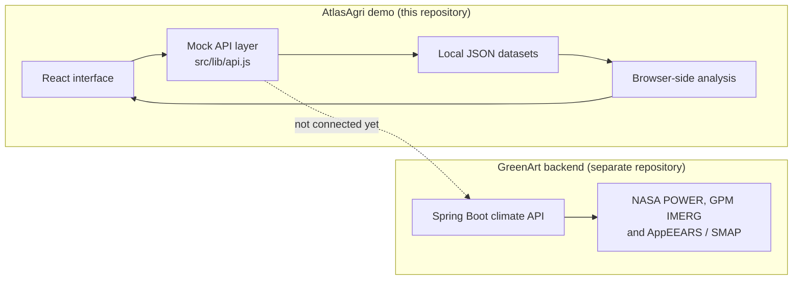

# AtlasAgri

**NASA-data-informed farming insights for Morocco.** AtlasAgri brings together climate and earth-observation data themes from NASA POWER (temperature), GPM IMERG (rainfall), and SMAP (soil moisture) in an interactive map and multilingual farm-planning demo. Farmers can explore local conditions, compare crop options, and review practical land-management considerations.

> **Demo notice:** AtlasAgri currently uses a mock API layer and local demonstration datasets. Climate and soil values are simulated or curated for the prototype; they are not live NASA measurements and must not be used to make real farming decisions. A separate GreenArt backend is in progress, but it is not connected to this demo yet.

[](https://react.dev/)
[](https://vite.dev/)
[](https://leafletjs.com/)

## High-level summary

AtlasAgri is a prototype for making climate, rainfall, soil, and crop-planning context easier to explore for Moroccan farming areas. Its map and multilingual dashboard bring these topics together in a farmer-oriented workflow. The current submission demonstrates the experience using simulated, NASA-inspired datasets; connecting the separate GreenArt backend and validating the data and agricultural guidance are future work.

## What you can explore

- An interactive map centered on NASA POWER temperature, GPM IMERG rainfall, and SMAP soil-moisture data, alongside crop-suitability context.
- Agricultural study areas across five Moroccan regions, with map-based location selection.
- A weather view, crop suitability cards, and side-by-side crop-rotation comparisons.
- A plain-language farm analysis built locally from the selected area's demo records.
- English, French, and Arabic interfaces, including right-to-left Arabic layout.
- Demonstration supplier listings and an optional sample soil-report flow.

The project is designed as a reviewable prototype: it demonstrates the user experience and analysis flow without presenting mock values as verified measurements.

## The problem and the project

### What I built

I built AtlasAgri, a multilingual, map-based farming decision-support prototype for Moroccan agricultural study areas. It brings climate, rainfall, soil-moisture, crop-suitability, and rotation context into one experience, then presents that context through weather views and a plain-language farm analysis. The current demo runs on local simulated datasets and browser-side analysis.

### What challenge it addresses

Climate and earth-observation datasets can be difficult to explore as raw technical records. AtlasAgri demonstrates one way to make those kinds of signals more approachable: organize them by place, show related conditions together, and connect them to crop and rotation comparisons in a farmer-facing interface. The demo is a prototype of that workflow, not evidence that it has already improved farm decisions or outcomes.

### Why it matters

Water availability, changing climate conditions, and soil health affect agricultural planning. Making relevant information easier to explore can help people ask better questions about local conditions and possible crop choices. AtlasAgri is intended to explore that opportunity for Morocco, while its simulated data and unvalidated assumptions mean it must not be used as real-world agronomic advice.

## Demo data and limitations

The frontend's data-loading functions are in [`src/lib/api.js`](src/lib/api.js). They simulate network delays and a recoverable rainfall error, then read the local datasets below. The analysis is composed in the browser; it is not generated by the GreenArt backend.

| Data shown | Local source | Status |
| --- | --- | --- |
| Temperature and precipitation context | [`src/data/nasa-power.json`](src/data/nasa-power.json) | Simulated NASA POWER-style records |
| Rainfall and normal values | [`src/data/gpm-imerg.json`](src/data/gpm-imerg.json) | Simulated GPM IMERG-style records |
| Soil moisture | [`src/data/smap.json`](src/data/smap.json) | Simulated SMAP-style records |
| Crop suitability | [`src/data/gaez.json`](src/data/gaez.json) | Simulated FAO GAEZ-style records |
| Crop rotations and study areas | [`src/data/rotations.json`](src/data/rotations.json), [`src/data/study-areas.json`](src/data/study-areas.json) | Demonstration data |
| Suppliers | [`src/data/suppliers.json`](src/data/suppliers.json) | Fictional, unverified listings |
| Soil indicators | [`src/data/soil-regions.json`](src/data/soil-regions.json), [`src/lib/lab.js`](src/lib/lab.js) | Regional assumptions and sample lab values |

The app's records are not a live feed. Attaching the example soil report does not perform OCR or extract laboratory results; the demo uses sample values and identifies them as such. Analysis thresholds and calculations are screening assumptions documented in [`src/lib/assumptions.js`](src/lib/assumptions.js), not official agronomic guidance.

## Technology

- React 19 and JavaScript
- Vite 8
- Leaflet and React Leaflet for maps
- Recharts for data visualizations
- Local JSON datasets; no database or backend connection is configured

## Architecture and backend status



The [GreenArt backend](https://github.com/Ayoub717542/GreenArt) is a separate work in progress intended to connect NASA POWER, GPM IMERG, and SMAP data, but it is not connected to this frontend yet. Integration is still pending: the frontend needs an API adapter and data aggregation/normalization, plus local CORS/proxy configuration. Until then, the frontend uses simulated records modeled on those datasets. Crop suitability, rotations, soil assumptions, and supplier listings also remain local demo data.

## Run locally

### Prerequisites

- Node.js and npm versions compatible with the Vite version in `package.json`.
- No backend credentials are needed to run the demo.

### Start the development server

```bash
git clone https://github.com/Ayoub717542/AtlasAgri.git
cd AtlasAgri
npm ci
npm run dev
```

Open the local URL printed by Vite, usually `http://localhost:5173`.

### Build and checks

```bash
npm run build
npm run lint
npm run check:keys
npm run check:analysis
npm run check:rotations
npm run smoke
```

## Using the demo

1. Open the map and select a study area or place a reference point.
2. Change map layers to explore the demonstration climate and crop context.
3. Review weather, soil, crop, and rotation views.
4. Open the farm analysis to see the staged demo flow and its assumptions.
5. Switch between English, French, and Arabic. A language can also be selected with `/?lang=ar` or `#/dashboard/map?loc=ouled-ayad&lang=fr`.

The selected language is saved in browser `localStorage`. Some location and map features depend on browser support and permissions.

## Repository layout

```text
src/
  components/  Map, dashboard, crop, rotation, supplier, and chat UI
  data/        Demonstration datasets and attribution metadata
  i18n/        English, French, and Arabic translations
  lib/         Mock API, analysis, map, formatting, and domain helpers
  pages/       Landing page and dashboard
public/        Static assets, crop images, and sample soil report
scripts/       Data and rendering checks
```

## Data attribution

Crop images include third-party material with attribution and license details in [`src/data/photo-credits.json`](src/data/photo-credits.json). Review those terms before redistributing the images.

## Contributing

Issues and pull requests are welcome. Keep the demo/live-data distinction visible, preserve the three supported languages, and do not describe demonstration values as measurements.

## License

No license file is currently included. Reuse and redistribution terms have not been specified.
